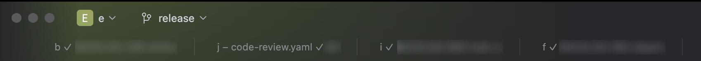

# Branch Tab Title

[](https://github.com/seunggabi/intellij-branch-tab-title/releases/latest)
[](https://github.com/seunggabi/intellij-branch-tab-title/stargazers)

[](https://plugins.jetbrains.com/plugin/35988-branch-tab-title)

**[Install from Marketplace](https://plugins.jetbrains.com/plugin/35988-branch-tab-title)** · **[⬇ Download latest](https://github.com/seunggabi/intellij-branch-tab-title/releases/latest)** · Settings → Plugins → ⚙ → Install Plugin from Disk

IntelliJ plugin that appends `⏳|✓ <branch>` to the project window title — useful when project windows are merged into tabs on macOS.

```
d ✓ release          a ⏳ feature/PROJ-123_add-login
```



- Branch: read from `.git/HEAD` (worktrees supported), refreshed every second
- ⏳: any terminal tab of the project whose title starts with `⏳` (set by your shell, below)
- Shorten names: Settings → Advanced Settings → **Branch Title**

| Setting | Default | Example |
|---|---|---|
| Branch regex | empty (full name) | `^feature/([A-Z]+-[0-9]+)_(.+)$` |
| Replacement | `$0` | `$1 $2` → `PROJ-123 add-login` |

Non-matching or invalid regex falls back to the full branch name.

## Terminal status (⏳/✓)

The plugin only reads terminal tab titles, so the shell has to set them.

1. Settings → Advanced Settings → Terminal → **Show application title**
2. zsh (`~/.zshrc`; with oh-my-zsh add `DISABLE_AUTO_TITLE="true"` before `source $ZSH/oh-my-zsh.sh`):

```zsh
autoload -Uz add-zsh-hook
_tab_branch() { local b; b=$(git branch --show-current 2>/dev/null); print -rn -- "${b:-${PWD:t}}" }
_tab_title() { print -rn -- $'\e]0;'"$1"$'\a' }
_tab_idle() { _tab_title "✓ $(_tab_branch)" }
_tab_busy() { _tab_title "⏳ $(_tab_branch)" }
add-zsh-hook precmd  _tab_idle
add-zsh-hook preexec _tab_busy
```

3. tmux (`~/.tmux.conf`) — pass pane titles to the outer terminal:

```tmux
set -g set-titles on
set -g set-titles-string "#T"
```

4. Claude Code — its own title does not change while working, so turn it off and set ⏳/✓ from hooks (`~/.claude/settings.json`: `"env": {"CLAUDE_CODE_DISABLE_TERMINAL_TITLE": "1"}`, `UserPromptSubmit` → busy, `Stop` → idle). See [`hooks/claude-tab-title.sh`](hooks/claude-tab-title.sh).

## Build

Compiles against the installed IntelliJ (2025.3+) — no Gradle.

```bash
./build.sh install
```

## Notes

- Uses internal IntelliJ API (`TitleInfoProvider`, `ProjectFrameHelper.updateTitle`) to refresh the window title, so it may break on IDE updates.
- Tested on IntelliJ IDEA 2025.3 (macOS, Classic terminal engine).

## Star history

[](https://star-history.com/#seunggabi/intellij-branch-tab-title&Date)

## License

MIT
